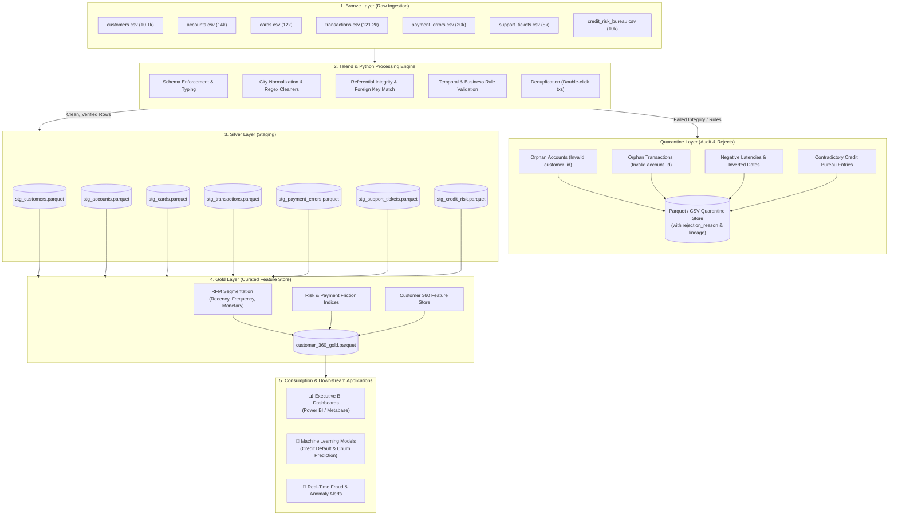

# 🇲🇦 Dirhamflow: Moroccan FinTech & Neo-Bank Data Engineering Pipeline

[-blue?style=for-the-badge&logo=databricks)](https://github.com/http-KAIJIN/Dirhamflow)
[](https://github.com/http-KAIJIN/Dirhamflow)
[](https://github.com/http-KAIJIN/Dirhamflow)
[](https://github.com/http-KAIJIN/Dirhamflow)
[](https://github.com/http-KAIJIN/Dirhamflow)

> [!NOTE]
> ### 👤 Project Origin & Authorship Disclosure
> **This project is 100% human-designed, architected, and led by [Oussama (http-KAIJIN)](https://github.com/http-KAIJIN).**  
> Artificial Intelligence (AI) was utilized strictly as an interactive coding pair-programmer and documentation assistant. All business requirements, architecture design choices, data modeling standards, and pipeline sequencing are human engineering decisions.
>
> 🤖 **Dataset Notice**: The raw dataset (~196,000 records across 7 relational domains) was synthetically generated using a custom autonomous AI script ([`generate_fintech_data.py`](file:///home/oussama/generate_fintech_data.py)). It was purpose-built to simulate realistic Moroccan banking production telemetry, including authentic business logic, national city distributions, local payment gateways (CMI), and intentional enterprise data anomalies (referential orphans, temporal paradoxes, double-click transactions, and dirty string entries).

---

## 📌 Executive Summary & Vision

**Dirhamflow** is an end-to-end Data Engineering and Analytics platform simulating the core data infrastructure of a modern Moroccan digital bank (Neo-Bank). 

In enterprise FinTech environments, raw transaction and customer logs arrive through disparate systems: core banking ledgers, mobile apps, card processing networks (CMI, Mastercard, Visa), KYC onboarding queues, CRM ticket engines, and credit risk bureaus. These streams inevitably suffer from data corruption, network retries, and schema violations.

Dirhamflow solves this by implementing an industrial **Medallion Architecture (Bronze ➔ Silver ➔ Gold)** with an active **Quarantine Branch**:
1. **Raw (Bronze)**: Ingests immutable, raw transactional logs and customer telemetry.
2. **Quarantine Branch**: Routes corrupted or logically invalid records (orphan foreign keys, inverted timestamps, negative latencies) into isolated quarantine storage with explicit audit failure reasons.
3. **Staging (Silver)**: Standardized, deduplicated, and schema-compliant Parquet datasets.
4. **Curated (Gold)**: Enriched analytical marts and a comprehensive **Customer 360 Feature Store** powering executive BI dashboards and downstream Credit Risk & Churn predictive models.

---

## 🏛 System Architecture & Pipeline Flow

The pipeline leverages a hybrid engineering approach: **Talend** for visual, enterprise-grade ETL data integration, referential integrity routing, and quarantine orchestration, alongside **Modern Python (PyArrow, Pandas, Scikit-learn)** for exploratory data profiling, feature engineering, and statistical modeling.



---

## 📊 Synthetic Production Datasets & Edge Case Lineage

All raw tables reside in [`data/raw/raw_data/`](file:///home/oussama/Dirhamflow/data/raw/raw_data). Each dataset contains specifically engineered production scenarios and realistic anomalies:

| Dataset | Volume | Primary Key / Keys | Simulated Edge Cases & Flaws to Clean |
|---|---|---|---|
| **`customers.csv`** | 10,100 rows | `customer_id` | • **Dirty City Variations**: `"casa"`, `"CASA"`, `"kech"`, `"fes "`, `" RABAT "` vs. standardized names.<br>• **Mixed Date Formats**: `YYYY-MM-DD`, `DD/MM/YYYY`, `MM-DD-YYYY`, `YYYY/MM/DD`.<br>• **Age Bounds**: Underage (<18) and impossible ages (>120).<br>• **Exact Duplicates**: ~1% redundant row duplication. |
| **`accounts.csv`** | 14,000 rows | `account_id` | • **Orphan Records**: ~1% accounts referencing non-existent `customer_id`.<br>• **Temporal Paradox**: ~2% accounts created prior to customer registration date.<br>• **Multi-currency**: MAD (95%), EUR, USD accounts across tiers (`STANDARD`, `PLUS`, `PREMIUM`, `VIP`). |
| **`cards.csv`** | 12,000 rows | `card_id` | • **Lifecycle Inconsistencies**: ~3% expired cards incorrectly marked as `ACTIVE`.<br>• **Security Violations**: ~2% active cards linked to `FROZEN` bank accounts. |
| **`transactions.csv`** | 121,200 rows | `tx_id` | • **Double-Click Duplicates**: ~1% identical amounts with a 1–3 second offset.<br>• **Negative Amounts**: ~2.5% chargebacks/reversals stored with negative signs.<br>• **Orphan Transactions**: ~1% transactions referencing invalid `account_id`. |
| **`payment_errors.csv`** | 20,000 rows | `error_id` | • **Gateway Telemetry**: Captures CMI, Visa Direct, Mastercard MDS, Stripe responses.<br>• **Negative Latencies**: ~2% records with negative response times (clock drift). |
| **`support_tickets.csv`** | 8,000 rows | `ticket_id` | • **Temporal Inversions**: ~1.5% tickets where `closed_at < opened_at`.<br>• **Sparse Feedback**: ~30% missing `satisfaction_score`. |
| **`credit_risk_bureau.csv`** | 10,000 rows | `customer_id` | • **Out-of-Bounds Scores**: Scores < 300 or > 900.<br>• **Contradictions**: Records with `total_debt_amount == 0` yet flagged as `defaulted == 1`. |

---

## 🎯 Key Learning Outcomes & Competencies

By designing and completing this project, the following core engineering disciplines are mastered:

1. **Enterprise Medallion Architecture**:
   - Structuring distinct, decoupled layers (Raw ➔ Silver ➔ Gold) with clear ownership, immutability, and lineage tracking.
2. **Talend ETL Mastery**:
   - Authoring modular ETL jobs utilizing components such as `tFileInputDelimited`, `tMap`, `tFilterRow`, `tJoin`, `tSchemaComplianceCheck`, and `tFileOutputParquet`.
   - Managing inner join lookups and isolating rejected records through automatic reject flows.
3. **Data Quality Engineering & Quarantine Pattern**:
   - Avoiding destructive deletions (`DROP ROW`) by implementing defensive quarantine routing with contextual metadata (`rejection_reason`, `ingestion_timestamp`).
4. **Modern Python & High-Performance Data Formats**:
   - Utilizing `pathlib` for environment-agnostic, portable path resolution.
   - Columnar data processing with **Apache Parquet** and **PyArrow** for drastic storage optimization and vectorized query speeds.
5. **FinTech Business Intelligence & Feature Store Design**:
   - Aggregating transactional telemetry into holistic behavioral profiles:
     - **Monetary Volumetrics**: 30-day velocity, rolling average transaction sizes.
     - **Friction Score**: Failed transaction ratios, payment timeout frequency.
     - **Credit Underwriting Indicators**: Debt-to-income approximations and bureau default risk.

---

## 📂 Repository Structure

```plaintext
Dirhamflow/
├── data/
│   ├── raw/
│   │   └── raw_data/          # 7 synthetic production CSV datasets (~196k rows)
│   ├── staging/               # Silver layer: Cleaned, validated Parquet files
│   ├── curated/               # Gold layer: Customer 360 Feature Store & BI Data Marts
│   └── quarantine/            # Segregated rejected records with audit failure reasons
│
├── notebooks/
│   ├── 1_EDA.ipynb            # Exploratory Data Analysis & initial data profiling
│   └── 2_EDA.ipynb            # Post-cleaning validation & feature store analysis
│
├── src/
│   ├── __init__.py
│   ├── config.py              # Dynamic paths (pathlib), environment settings, and loggers
│   ├── 01_clean_entities.py   # Customer, Account, and Card cleaning modules
│   ├── 02_clean_events.py     # Transaction, Error, and Ticket processing
│   ├── 03_integrity.py        # Cross-table referential integrity & quarantine router
│   └── 04_build_features.py   # Gold layer: Customer 360 analytical feature store
│
├── tests/                     # Automated unit and data quality assertions (pytest)
├── main.py                    # End-to-end Python pipeline orchestrator
├── requirements.txt           # Explicit project dependencies
├── .gitignore                 # Enterprise hygiene (ignores venvs, checkpoints, temp files)
└── README.md                  # Project architecture & master documentation
```

---

## 🚀 Getting Started

### Prerequisites
- **Linux (Arch / Ubuntu / Debian) or macOS**
- **Python 3.11+**
- **[uv](https://github.com/astral-sh/uv)** (Recommended high-performance Python package runner)
- **Talend Open Studio for Data Integration (v8.0+)**

### 1. Clone the Repository
```bash
git clone https://github.com/http-KAIJIN/Dirhamflow.git
cd Dirhamflow
```

### 2. Environment Setup with `uv`
```bash
# Create virtual environment
uv venv .venv

# Activate environment
source .venv/bin/activate

# Install project dependencies
uv pip install -r requirements.txt
```

### 3. Verify Configuration
```bash
# Verify directory paths and raw dataset presence
python src/config.py
```

---

## 🗺 Project Milestones & Roadmap

- [x] **Milestone 1**: Problem definition, data generation, and repository scaffolding.
- [x] **Milestone 2**: Medallion directory architecture and dynamic configuration (`src/config.py`).
- [x] **Milestone 3**: Raw data profiling & Exploratory Data Analysis ([`1_EDA.ipynb`](file:///home/oussama/Dirhamflow/notebooks/1_EDA.ipynb)).
- [ ] **Milestone 4**: Talend ETL job authoring (Schema compliance, foreign key validation, quarantine routing).
- [ ] **Milestone 5**: Silver Staging Parquet generation (`data/staging/`).
- [ ] **Milestone 6**: Gold layer Customer 360 Feature Store engineering (`data/curated/`).
- [ ] **Milestone 7**: Executive FinTech Dashboard (Power BI / Metabase) & Credit Risk modeling.

---

## 👨‍💻 Author & Contact

**Oussama (http-KAIJIN)**  
*FinTech Data & Software Engineering*  
GitHub: [@http-KAIJIN](https://github.com/http-KAIJIN)
