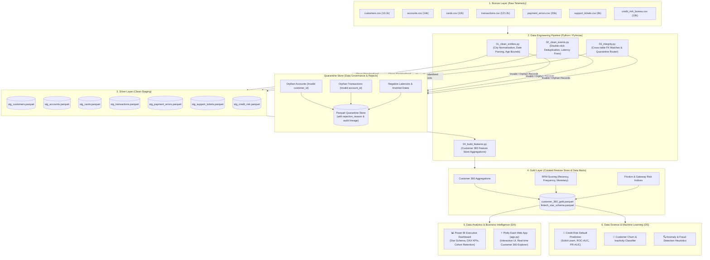

# 🇲🇦 Dirhamflow: End-to-End Moroccan FinTech Data Platform
### 🛠️ Data Engineering (DE) • 📈 Data Analytics (DA) • 🤖 Data Science (DS)

[-blue?style=for-the-badge&logo=databricks)](https://github.com/http-KAIJIN/Dirhamflow)
[](https://github.com/http-KAIJIN/Dirhamflow)
[](https://github.com/http-KAIJIN/Dirhamflow)
[](https://github.com/http-KAIJIN/Dirhamflow)
[](https://github.com/http-KAIJIN/Dirhamflow)

> [!NOTE]
> ### 👤 Project Origin & Authorship Disclosure
> **This project is 100% human-designed, conceptualized, and architected by [Oussama (http-KAIJIN)](https://github.com/http-KAIJIN).**  
> Artificial Intelligence (AI) was utilized strictly as an interactive coding pair-programmer and technical documentation assistant. All business logic, pipeline architectures, data modeling designs, analytical KPI formulas, and ML strategies are human engineering decisions.
>
> 🤖 **Dataset Notice**: The raw dataset (~196,000 records across 7 relational domains) was synthetically generated using a custom autonomous AI script ([`generate_fintech_data.py`](file:///home/oussama/generate_fintech_data.py)). It was purpose-built to simulate realistic Moroccan banking production telemetry, including authentic business logic, national city distributions, local payment gateways (CMI), and intentional enterprise data anomalies (referential orphans, temporal paradoxes, double-click transactions, and dirty string entries).

---

## 📌 Executive Summary & Vision

**Dirhamflow** is an enterprise-grade, end-to-end data platform built around the core telemetry of a modern Moroccan digital bank (Neo-Bank). Rather than treating data disciplines in silos, Dirhamflow unifies the complete **Data Triad**:

1. **Data Engineering (DE)**: Constructs an automated, resilient **Medallion Architecture (Bronze ➔ Silver ➔ Gold)** in pure modern Python (PyArrow, Pandas). It enforces referential integrity, eliminates duplicates, handles schema drift, and segregates corrupt records into a dedicated **Quarantine Branch**.
2. **Data Analytics (DA) & Business Intelligence (BI)**: Transforms clean staging data into actionable executive insights through two synchronized presentation layers:
   - **Power BI Dashboard**: Executive Star Schema model with advanced DAX measures for financial health, merchant channel velocity, revenue, and customer retention.
   - **Plotly Dash Web Application ([`app.py`](file:///home/oussama/Dirhamflow/app.py))**: A full-stack interactive Python web dashboard providing real-time filtering, transaction flow diagnostics, and customer 360 exploration.
3. **Data Science (DS) & Machine Learning (ML)**: Leverages the Curated Gold Feature Store to build predictive models:
   - **Credit Risk & Loan Underwriting Model**: Predicts probability of default ($PD$) using bureau records (`credit_risk_bureau.csv`) and transactional behavior.
   - **Customer Churn & Inactivity Predictor**: Classifies dormant accounts and predicts churn risk using RFM behavioral segments.

---

## 🏛 System Architecture & End-to-End Pipeline



---

## 🔬 The Three Pillars: DE • DA • DS

### 1. 🛠️ Data Engineering (DE)
* **Medallion Pipeline**: Custom, modular Python stages ([`src/`](file:///home/oussama/Dirhamflow/src)) converting dirty raw CSVs into highly compressed, query-optimized Apache Parquet files.
* **Referential Integrity & Quarantine Routing**: Rather than blindly dropping bad rows (`dropna()`), records with referential violations (orphan accounts without customers, orphan transactions without accounts) are routed to `data/quarantine/` with lineage audit trails.
* **Data Cleansing Algorithms**:
  - Resolves mixed international date formats (`YYYY-MM-DD`, `DD/MM/YYYY`, `MM-DD-YYYY`) in `birth_date`.
  - Normalizes Moroccan city names via dictionary mapping (`"casa"`, `"CASA"`, `"kech"`, `"fes "` ➔ `"Casablanca"`, `"Marrakech"`, `"Fes"`).
  - Identifies and eliminates "double-click" transactional duplicates occurring within a 1–3 second window.

### 2. 📈 Data Analytics (DA) & Visual Intelligence
* **Power BI Dashboard**:
  - Structured on a star schema with high-performance DAX measures.
  - Analyzes transaction volumetrics (MAD), gateway failure rates (CMI vs Visa Direct vs Mastercard), merchant category spending (MCC codes), and KYC funnel conversion.
* **Interactive Web App with Plotly Dash ([`app.py`](file:///home/oussama/Dirhamflow/app.py))**:
  - Built with **Dash** and modern CSS/HTML for interactive exploration.
  - Includes a real-time **Customer 360 Search Console**: inspect individual account balances, transaction timelines, credit bureau standing, and support ticket history.

### 3. 🤖 Data Science (DS) & Predictive Modeling
* **Credit Risk & Loan Default Scoring**:
  - Analyzes the `credit_risk_bureau.csv` dataset joined with actual account spending velocity.
  - Trains supervised classification models (Logistic Regression, Random Forest, XGBoost) to predict probability of loan default ($PD$).
  - Addresses class imbalance, inspects feature importance (debt-to-income, days past due, transaction friction), and validates models using stratified cross-validation and ROC-AUC / PR-AUC.
* **Customer Lifetime Value (LTV) & RFM Segmentation**:
  - Algorithmic segmentation of users into VIP, High-Volume Spenders, Dormant, and High-Churn-Risk cohorts.

---

## 📊 Synthetic Production Datasets & Edge Case Lineage

All raw tables reside in [`data/raw/raw_data/`](file:///home/oussama/Dirhamflow/data/raw/raw_data). Each dataset contains specifically engineered production scenarios and realistic anomalies:

| Dataset | Volume | Primary Key / Keys | Simulated Edge Cases & Flaws to Clean |
|---|---|---|---|
| **`customers.csv`** | 10,100 rows | `customer_id` | • **Dirty City Variations**: `"casa"`, `"CASA"`, `"kech"`, `"fes "`, `" RABAT "` vs. standardized names.<br>• **Mixed Date Formats**: `YYYY-MM-DD`, `DD/MM/YYYY`, `MM-DD-YYYY`, `YYYY/MM/DD`.<br>• **Age Bounds**: Underage (<18) and impossible ages (>120).<br>• **Exact Duplicates**: ~1% redundant row duplication. |
| **`accounts.csv`** | 14,000 rows | `account_id` | • **Orphan Records**: ~1% accounts referencing non-existent `customer_id`.<br>• **Temporal Paradox**: ~2% accounts created prior to customer registration date.<br>• **Multi-currency**: MAD (95%), EUR, USD accounts across tiers (`STANDARD`, `PLUS`, `PREMIUM`, `VIP`). |
| **`cards.csv`** | 12,000 rows | `card_id` | • **Lifecycle Inconsistencies**: ~3% expired cards incorrectly marked as `ACTIVE`.<br>• **Security Violations**: ~2% active cards linked to `FROZEN` bank accounts. |
| **`transactions.csv`** | 121,200 rows | `tx_id` | • **Double-Click Duplicates**: ~1% identical amounts with a 1–3 second offset.<br>• **Negative Amounts**: ~2.5% chargebacks/reversals stored with negative signs.<br>• **Orphan Transactions**: ~1% transactions referencing invalid `account_id`. |
| **`payment_errors.csv`** | 20,000 rows | `error_id` | • **Gateway Telemetry**: Captures CMI, Visa Direct, Mastercard MDS, Stripe responses.<br>• **Negative Latencies**: ~2% records with negative response times (clock drift). |
| **`support_tickets.csv`** | 8,000 rows | `ticket_id` | • **Temporal Inversions**: ~1.5% tickets where `closed_at < opened_at`.<br>• **Sparse Feedback**: ~30% missing `satisfaction_score`. |
| **`credit_risk_bureau.csv`** | 10,000 rows | `customer_id` | • **Out-of-Bounds Scores**: Scores < 300 or > 900.<br>• **Contradictions**: Records with `total_debt_amount == 0` yet flagged as `defaulted == 1`. |

---

## 🎯 Key Learning Outcomes & Competencies

By designing and completing this project, the following core competencies across the Data spectrum are gained:

```
┌───────────────────────────────────────────────────────────────────────────────┐
│                           DIRHAMFLOW LEARNING OUTCOMES                        │
├───────────────────────┬───────────────────────────────┬───────────────────────┤
│  Data Engineering     │  Data Analytics & BI          │  Data Science & ML    │
├───────────────────────┼───────────────────────────────┼───────────────────────┤
│ • Medallion Design    │ • Executive BI Dashboards     │ • Credit Risk Models  │
│ • Parquet & PyArrow   │ • Star Schema & Data Modeling │ • Imbalanced Datasets │
│ • Quarantine Routing  │ • Advanced DAX Expressions    │ • ROC-AUC / PR-AUC    │
│ • Referential Integrity│ • Plotly Dash Web Apps       │ • Feature Store Eng.  │
│ • Pipeline Automation │ • Cohort & RFM Analysis       │ • Churn Prediction   │
└───────────────────────┴───────────────────────────────┴───────────────────────┘
```

---

## 📂 Repository Structure

```plaintext
Dirhamflow/
├── data/
│   ├── raw/
│   │   └── raw_data/          # 7 synthetic production CSV datasets (~196k rows)
│   ├── staging/               # Silver layer: Cleaned, validated Parquet files
│   ├── curated/               # Gold layer: Customer 360 Feature Store & BI Data Marts
│   └── quarantine/            # Segregated rejected records with audit failure reasons
│
├── notebooks/
│   ├── 1_EDA.ipynb            # Exploratory Data Analysis & initial data profiling
│   └── 2_EDA.ipynb            # Post-cleaning validation & feature store analysis
│
├── src/
│   ├── __init__.py
│   ├── config.py              # Dynamic paths (pathlib), environment settings, and loggers
│   ├── 01_clean_entities.py   # Customer, Account, and Card cleaning modules
│   ├── 02_clean_events.py     # Transaction, Error, and Ticket processing
│   ├── 03_integrity.py        # Cross-table referential integrity & quarantine router
│   └── 04_build_features.py   # Gold layer: Customer 360 analytical feature store
│
├── dashboards/                # Power BI reporting files (.pbix) and visual assets
├── app.py                     # Plotly Dash interactive web application
├── main.py                    # End-to-end Python pipeline orchestrator
├── tests/                     # Automated unit and data quality assertions (pytest)
├── requirements.txt           # Explicit project dependencies
├── .gitignore                 # Enterprise hygiene (ignores venvs, checkpoints, temp files)
└── README.md                  # Project architecture & master documentation
```

---

## 🚀 Getting Started

### Prerequisites
- **Linux (Arch / Ubuntu / Debian) or macOS**
- **Python 3.11+**
- **[uv](https://github.com/astral-sh/uv)** (Recommended modern package runner)

### 1. Clone the Repository
```bash
git clone https://github.com/http-KAIJIN/Dirhamflow.git
cd Dirhamflow
```

### 2. Environment Setup with `uv`
```bash
# Create virtual environment
uv venv .venv

# Activate environment
source .venv/bin/activate

# Install project dependencies
uv pip install -r requirements.txt
```

### 3. Verify Configuration
```bash
python src/config.py
```

### 4. Launch Dash Application (Interactive UI)
```bash
python app.py
```

---

## 🗺 Project Milestones & Roadmap

- [x] **Milestone 1**: Problem definition, data generation, and repository scaffolding.
- [x] **Milestone 2**: Medallion directory architecture and dynamic configuration (`src/config.py`).
- [x] **Milestone 3**: Raw data profiling & Exploratory Data Analysis ([`1_EDA.ipynb`](file:///home/oussama/Dirhamflow/notebooks/1_EDA.ipynb)).
- [ ] **Milestone 4 (DE)**: Python cleaning & referential integrity pipeline (`01_` through `03_`).
- [ ] **Milestone 5 (DE)**: Silver Staging Parquet generation (`data/staging/`).
- [ ] **Milestone 6 (DE/DS)**: Gold Customer 360 Feature Store engineering (`data/curated/`).
- [ ] **Milestone 7 (DA)**: Power BI Dashboard (.pbix) with Star Schema & DAX KPIs.
- [ ] **Milestone 8 (DA)**: Interactive Plotly Dash Web Application (`app.py`).
- [ ] **Milestone 9 (DS)**: Credit Risk Probability of Default ($PD$) machine learning model.

---

## 👨‍💻 Author & Contact

**Oussama (http-KAIJIN)**  
*FinTech Data & Software Engineering*  
GitHub: [@http-KAIJIN](https://github.com/http-KAIJIN)
